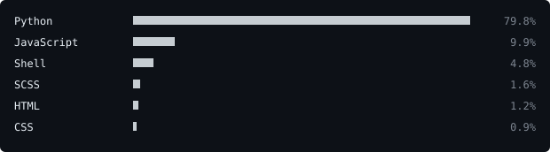

[github](https://github.com/JustJoyful) &nbsp;·&nbsp;
[linkedin](https://www.linkedin.com/in/joydeep-das-a2016a388) &nbsp;·&nbsp;
[email](mailto:joydeepdas217@gmail.com)

> CS student at NSEC, Kolkata. 
> Local-first tools, honest benchmarks, boring reliable pipelines.

I like building things that run on my own machine and show their working. Lately that's 
[AxiomLM](https://github.com/JustJoyful/AxiomLM), a textbook study assistant on a local LLM, and 
[Testcard](https://github.com/JustJoyful/Testcard), a video-quality benchmark with reproducible results.

<samp>python &nbsp; javascript &nbsp; react &nbsp; pytorch &nbsp; fastapi &nbsp; htmx &nbsp; sqlite &nbsp; dynamodb &nbsp; docker &nbsp; terraform &nbsp; aws &nbsp; ollama &nbsp; shell &nbsp; linux</samp>

**[Testcard](https://github.com/JustJoyful/Testcard)** &nbsp;·&nbsp; <samp>python, pytorch, dinov2</samp> 
Reproducible no-reference video quality benchmark: ResNet-50 vs DINOv2 features and four 
temporal heads. Ships a Docker CPU demo that scores an uploaded clip.

**[AxiomLM](https://github.com/JustJoyful/AxiomLM)** &nbsp;·&nbsp; <samp>python, ollama, textual</samp> 
Terminal study assistant for STEM textbooks. Local OCR, hybrid retrieval and 
sandboxed SymPy math, all on a local model.

**[VGC-Telemetry](https://github.com/JustJoyful/VGC-Telemetry)** &nbsp;·&nbsp; <samp>python, fastapi, dynamodb, terraform</samp> 
Self-hosted Pokémon VGC analytics: tournament ingestion, a snapshot REST API 
and an interactive meta explorer.

**[SPEAK](https://github.com/JustJoyful/SPEAK)** &nbsp;·&nbsp; <samp>python, react, fastapi, whisper</samp> 
Voice to FHIR clinical notes with on-device PII masking. Smart India Hackathon 2026, 
Team OPSEC.

